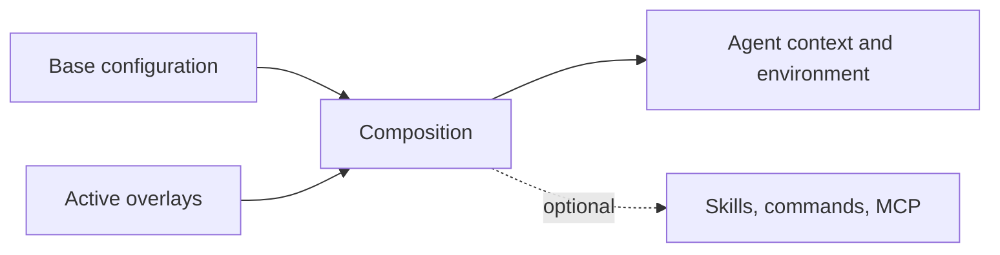

# Composition

Composition combines the declarations and assets of the active overlays. **The format does not
prescribe a target configuration.** A manager documents the composition it implements.

## Deterministic ordering

**Core.** The active overlays are sorted ascending by the triple `(priority, name, identity)`, where
`name` is the manifest `name`, or the identity when it is absent or empty, and strings compare by
their Unicode scalar values (equivalently, their UTF-8 bytes), never by UTF-16 code units. A
consumer MUST use this order wherever overlays contribute in order: rules, routing, context,
environment and skills. The overlay with the higher `priority` comes later, and so wins a conflict.
`requires` does not change the order.

`priority` is the author's suggestion. A consumer's configuration MAY set or cap the priority of an
overlay it installs, so that an overlay from elsewhere cannot place itself above the ones its user
trusts; the order then uses that value.

`priority` orders contributions; it does not make a later file replace an earlier one.

## Merging

**Core.** `rules` names Markdown files of always-on instructions and `routing` holds lines that tell
an agent which file to read for which task. A consumer adds both, overlay by overlay in composition
order, after its base configuration's own, and MUST preserve every entry. The `rules`
[default](package.md#defaults), every `rules/<name>.md` directly in `rules/` ordered by path bytes,
comes before the listed files (**Proposed**).

> **Status:** dotagents merges them into a marker-delimited managed block of `AGENTS.md`: from each
> rules file, the leading run of `- **` bullets up to the next `## ` heading goes into the always-on
> section; routing lines are appended to the load-on-demand section. It recomposes from a pristine
> base on every change, so the result does not depend on the order overlays were added, and text
> outside the markers is kept. Where the result lands is dotagents policy.

Context files, environment, skills and commands compose in the same order; their sections say how:
[context](harness.md#context), [environment](environment.md#order-of-application),
[skills](skills.md#delivery), [commands](commands.md#scripts).

## Scope precedence and duplicate names

AOS does not define system, user or project scopes; a [scope](terminology.md) is only a set of
overlays a consumer installs together, which [dependency environments](runtime.md#environments)
are shared within. Two overlays whose identities normalize to the
same name are one overlay; a consumer MUST NOT apply both, and SHOULD say which copy it uses.

> **Status:** dotagents reads system, user and project stores in that order; an overlay in a later
> store shadows a same-named one in an earlier store entirely.

## Conflicts and removal

A consumer makes replacement, collision and removal policy explicit, and recomputes derived output
from the base and the active overlays rather than editing it incrementally. On removal it takes away
only what that overlay contributed.

> **Status:** dotagents installs each overlay into its own directory, publishes skills to a shared
> directory and tracks their publisher, refuses two overlays declaring one script name, and on
> removal recomposes and unpublishes only that overlay's skills.
