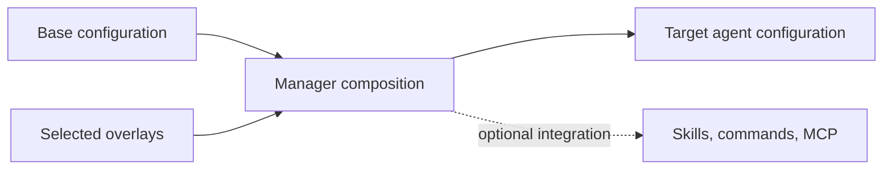

# Composition

Composition combines declarations and assets from selected overlays. **The package format does not prescribe a universal target configuration.** A manager MUST document the composition behavior it implements.

## Deterministic ordering

For AOS-aware composition, implementations SHOULD choose a stable ordering and MUST use the same ordering for the same effective inputs. Dotagents orders contributions by ascending `priority` (default 500), then manifest `name`, then directory name. It adds base content first, then overlay contributions. Its higher-priority overlay is later in the output. This ordering does not define runtime instruction precedence in every agent product.

## Merging

Dotagents merges `rules` and `routing` into a marker-delimited managed `AGENTS.md` block. Rules are inserted into the always-on section; routing is appended to the load-on-demand section. Recomposition starts from a pristine base and folds all installed overlays in order, making the result independent of add order. Text outside the managed markers is preserved.

This behavior is a **dotagents manager policy**. Another manager MAY map these fields into different target files. It SHOULD preserve all entries and make conflict behavior visible.

## Scope precedence and duplicate names

Dotagents reads system, user, project, then project-root locations. For same normalized overlay name across stores, the more specific later store shadows the broader copy entirely; it does not stack those copies. AOS does not define system/user/project scopes. Consumers MUST NOT assume a universal scope hierarchy.

Two directories that normalize to the same identity collide. Dotagents' resolution and discovery behavior is implementation-defined across malformed or manually assembled installations. A conforming manager SHOULD reject duplicate normalized identities or report which copy wins.

## Conflicts and removal

Priority controls order, not file overwrite. Dotagents installs overlays into separate directories and publishes skill assets to a shared location; same-name script launchers fail with a collision, and published skills are tracked per publisher. On removal it recomposes the managed block and unpublishes only assets attributed to that overlay. These lifecycle details are implementation-specific.

Consumers SHOULD make replacement, collision, and removal policy explicit. Managers SHOULD recompute derived output from the selected base and active overlays instead of relying on historical incremental edits.
