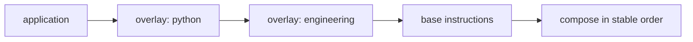

# Dependencies

`requires` is a list of overlay names. It identifies required packages; it does not itself say where to obtain them or whether to execute them.

## Dotagents compatibility behavior

`dotagents overlays add` installs named requirements first unless already present. Names are validated and normalized; invalid entries are ignored and duplicate normalized names are removed. Listing and showing can flag requirements with no installed provider. Removal refuses to remove a required overlay unless forced. The format does not encode version ranges, optional dependencies, or source pins.

## AOS manager guidance

A manager that resolves dependencies SHOULD:

- resolve each required name to exactly one package using a documented source precedence;
- install or activate prerequisites before the dependent overlay;
- detect cycles and fail with a readable dependency chain;
- report missing dependencies before partially applying composition;
- distinguish a package name from a registry alias and a source location;
- make the result deterministic and record source identity and revision.

These are **manager recommendations**, not verified requirements of every dotagents path. Dotagents behavior for cyclic and conflicting manually installed graphs is not a portable contract in this draft.

**Proposed:** a future versioned extension may define dependency version constraints and lock data. Existing overlays need no migration for this draft.
