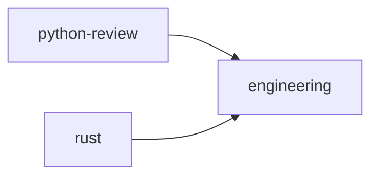

# Dependencies

**Core.** `requires` lists overlay names the overlay needs. It says nothing about where to obtain
them; that is the consumer's [source](distribution.md) configuration.

## Resolution

A resolver computes the active overlays from the ones it was asked for:

1. Visit each requested overlay in the order given. Visiting an overlay visits each of its
   `requires`, normalized, in order, then adds the overlay itself, once.
2. An overlay reached again while it is being visited is a **cycle**: an error that names the chain,
   `a -> b -> a`.
3. A required name no source offers is **missing**: reported with the overlay that requires it.
4. The active overlays are every overlay added. They are then sorted into
   [composition order](composition.md#deterministic-ordering); the visiting order decides only what
   is installed first.

A resolver MUST report every cycle and missing requirement before it applies any composition. It
MAY refuse (a session that must be complete) or continue without the missing overlay (an
interactive install), and says which it does.

> **Status:** dotagents' `overlays add` installs requirements first, depth first; a cycle is an
> error; a requirement no source offers is a warning and the requested overlay still installs.
> Removal refuses to remove an overlay another requires unless forced.

There are no version constraints, optional dependencies or source pins in `requires`. A consumer pins
the overlays it installs in its own configuration ([Integrity](integrity.md)). `requires` names
overlays; the skills an overlay needs are in its [`skills`](skills.md#declaring-skills), which may say
where to fetch each.
